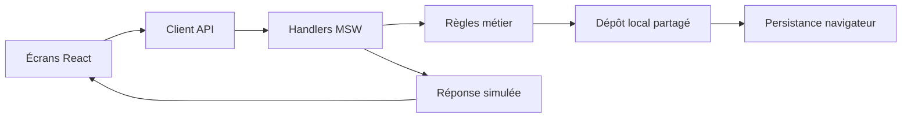

# AgriData Connect

## PRD du prototype web interactif

| Métadonnée | Valeur |
| --- | --- |
| Version | 1.0 |
| Date | 7 novembre 2026 |
| Responsable technique | Bachirou |
| Usage | Référence pour développer et valider le prototype universitaire |
| Plateforme | Site web, laptop first, adapté au mobile |
| Langue | Français |
| Technologies retenues | React, TypeScript, Vite, CSS, Mock Service Worker |
| Nature du livrable | Front-end interactif avec backend simulé et données locales |

Ce document décrit exclusivement le prototype à réaliser. Les parcours, écrans, calculs et changements d'état doivent fonctionner dans le navigateur. Ils ne constituent ni un système de paiement réel ni une infrastructure commerciale opérationnelle.

Les choix explicitement validés par l'équipe sont identifiés comme tels. Les conventions de démonstration ci-dessous complètent les détails nécessaires à l'implémentation ; elles ne fixent pas la politique commerciale de la future entreprise.

## Sommaire

1. Objectif et résultat attendu
2. Périmètre et priorités
3. Utilisateurs, accès et navigation
4. Parcours utilisateurs
5. Exigences fonctionnelles
6. Inventaire des écrans
7. Règles métier et états
8. Données de démonstration
9. Direction artistique et ergonomie
10. Architecture et simulation du backend
11. Contrat des API simulées
12. Critères d'acceptation
13. Scénario de présentation
14. Ordre de réalisation et livrables
15. Références et décisions

## 1. Objectif et résultat attendu

### 1.1. Ce que le prototype doit démontrer

AgriData Connect permet à un agriculteur de vendre un lot et à un acheteur de commander des produits agricoles en gros. Les utilisateurs peuvent publier une offre ou une demande, échanger et négocier. La plateforme coordonne le transport après le paiement et suit la commande jusqu'au versement à l'agriculteur ou à la résolution d'un litige.

La démonstration doit rendre visibles cinq capacités :

- Mettre en relation les agriculteurs et les acheteurs.
- Acheter directement au prix affiché ou négocier le prix et la quantité.
- Créer une commande et simuler son règlement par carte ou en agence.
- Suivre la collecte et la livraison depuis les espaces des deux parties.
- Confirmer la réception, traiter un problème et finaliser le règlement.

### 1.2. Définition de la réussite

- Un présentateur peut parcourir les trois rôles dans un même navigateur sans recréer les données.
- Une action dans un espace produit un changement cohérent dans les autres espaces.
- Les données, montants et statuts restent identiques après rechargement.
- Une démonstration normale et une démonstration avec litige aboutissent chacune à une clôture explicable.
- Les principaux parcours fonctionnent sur ordinateur et restent utilisables sur mobile.
- Aucun bouton essentiel ne conduit à une page vide ou à une action sans effet.

## 2. Périmètre et priorités

### 2.1. P0 : indispensable à la livraison du prototype

| Domaine | Fonctionnalités incluses |
| --- | --- |
| Accès | Profils de démonstration, changement de rôle, déconnexion simulée, modification du profil |
| Offres | Catalogue, recherche et filtres, détail, publication, modification, désactivation |
| Demandes | Publication d'un besoin acheteur, consultation par les agriculteurs, proposition commerciale |
| Échanges | Conversations, messages locaux, propositions structurées, acceptation ou refus |
| Commandes | Achat direct ou négocié, contrôle de quantité, récapitulatif, création, liste et détail |
| Paiements | Naps simulé, Cash Plus simulé, réussite, échec, attente et nouvelle tentative |
| Livraison | Organisation par l'administration, étapes datées, réception confirmée par l'acheteur |
| Litiges | Signalement, preuve de démonstration, échanges, décision et exécution d'une résolution |
| Règlements | Commission fictive, montant dû au producteur, versement simulé, clôture |
| Notifications | Notifications internes persistantes, lecture et journal des e-mails simulés |
| Administration | Gestion des commandes, livraisons, paiements, règlements, litiges et modération simple |
| Démonstration | Jeu initial, sélecteur de profil, simulation des résultats et réinitialisation |

### 2.2. P1 : compléments après validation des parcours P0

- Inscription locale d'un compte acheteur ou agriculteur et récupération de mot de passe simulée.
- Comparateur dédié de deux ou trois offres de même produit et unité.
- Graphique d'évolution des prix à partir d'un historique fictif explicitement sourcé.
- Import d'images personnelles, au-delà de la bibliothèque d'images de démonstration.
- Export d'un récapitulatif de commande.

La comparaison des prix par consultation du catalogue reste P0. Aucun écran P1 inachevé ne doit être exposé avec un bouton inactif : masquer son accès tant qu'il n'est pas développé.

### 2.3. Hors périmètre

- Backend réel, base de données distante, authentification sécurisée ou validation d'identité.
- Connexion réelle à Naps, Cash Plus, un service bancaire ou un transporteur.
- Paiement, remboursement, séquestre ou reversement d'argent réel.
- E-mails réels, SMS, WhatsApp et notifications push.
- Géolocalisation du véhicule, optimisation d'itinéraires et espace transporteur.
- Synchronisation entre appareils, messagerie temps réel réseau ou collaboration multi-onglets garantie.
- Application mobile native, version arabe et gestion multilingue.
- Gestion hors ligne avec file d'attente et synchronisation à la reconnexion.
- Panier multi-agriculteurs, facturation fiscale, contrats et contrôle qualité réel.
- Avis clients, abonnements commerciaux, recommandations IA et prévisions de marché.

## 3. Utilisateurs, accès et navigation

### 3.1. Rôles

| Rôle | Objectif | Actions autorisées |
| --- | --- | --- |
| Acheteur | Trouver et recevoir des produits en gros | Consulter les offres, publier ses demandes, discuter, accepter une proposition, commander, payer, confirmer la réception, signaler un problème |
| Agriculteur | Vendre ses lots et suivre ses règlements | Publier ses offres, répondre aux demandes, négocier, voir ses commandes et leur livraison, consulter ses versements |
| Administrateur | Coordonner et finaliser les transactions | Consulter les commandes, organiser les transports, suivre les paiements, gérer les litiges, effectuer les versements, modérer les annonces |

Les acheteurs peuvent être des professionnels ou des particuliers achetant en gros. Les coopératives utilisent le rôle agriculteur. Aucun utilisateur ne doit chercher ou réserver lui-même un transporteur.

### 3.2. Accès de démonstration

- Une page d'entrée permet de choisir un profil fictif sans fournir de vrai mot de passe.
- Un bandeau discret et permanent indique « Démonstration : données et paiements simulés ».
- Le bandeau contient « Changer de profil » et « Réinitialiser la démonstration ».
- Le changement de profil ne modifie pas les données métier. Il redirige vers l'accueil du nouvel espace et recharge ses informations.
- La réinitialisation exige une confirmation, restaure tout le jeu initial et revient à la page d'entrée.
- Les contrôles de rôle s'appliquent dans les écrans et dans les handlers MSW. Ce sont des contrôles de cohérence du prototype, pas une sécurité de production.
- L'identité sélectionnée est transmise aux API simulées, par exemple avec `X-Demo-User-Id`.
- Un utilisateur ne peut lire que ses conversations, commandes, notifications et demandes privées. Le catalogue public reste accessible à tous.
- L'administrateur ne peut pas confirmer une réception à la place de l'acheteur.

### 3.3. Navigation

| Espace | Navigation |
| --- | --- |
| Acheteur | Catalogue, Mes demandes, Messages, Mes commandes, Mon profil |
| Agriculteur | Mes offres, Demandes d'achat, Messages, Commandes reçues, Mes règlements, Mon profil |
| Administration | Tableau de bord, Commandes et livraisons, Paiements et versements, Litiges, Utilisateurs et annonces |

La cloche de notifications et les outils de démonstration sont communs aux trois espaces. Les profils publics des agriculteurs peuvent être présentés dans un panneau depuis une offre, sans page supplémentaire obligatoire.

## 4. Parcours utilisateurs

### 4.1. Achat direct et réception conforme

1. L'agriculteur publie une offre disponible.
2. L'acheteur recherche le produit, consulte l'offre et choisit la quantité.
3. Il vérifie le prix, l'adresse, les frais et l'estimation de livraison.
4. Il confirme la commande ; le stock est réservé et la commande devient visible dans l'administration.
5. Il simule un paiement réussi.
6. L'administrateur planifie la collecte, puis enregistre la récupération et le départ en livraison.
7. Il signale la remise des produits au destinataire.
8. L'acheteur confirme une réception conforme.
9. L'administrateur effectue le versement simulé à l'agriculteur.
10. La commande est clôturée et reste consultable par les deux parties.

L'achat direct n'exige aucune nouvelle acceptation de l'agriculteur. Le prix et la disponibilité publiés permettent de commander.

### 4.2. Négociation depuis une offre

1. L'acheteur ouvre une discussion liée à l'offre.
2. Une partie propose un prix unitaire et une quantité structurés.
3. L'autre partie accepte ou refuse, ou émet une contre-proposition.
4. Une proposition acceptée permet à l'acheteur d'ouvrir le récapitulatif prérempli.
5. La disponibilité est contrôlée de nouveau lors de la confirmation de commande.
6. La suite est identique au parcours d'achat direct.

### 4.3. Demande publiée par l'acheteur

1. L'acheteur décrit son besoin et sa destination.
2. Un agriculteur consulte la demande et propose un lot issu de ses offres.
3. Une conversation et une proposition structurée sont créées.
4. L'acheteur accepte directement ou négocie.
5. Une proposition acceptée conduit à une commande indépendante pour cet agriculteur.

Plusieurs agriculteurs peuvent répondre à une demande. Pour simplifier le prototype, une demande P0 ne produit qu'une commande ; elle passe à « Commandée » à la création et les autres propositions deviennent indisponibles. Une nouvelle demande est créée pour un autre achat. Si cette commande est annulée avant paiement, la demande est rouverte ; les autres propositions restent à renouveler.

### 4.4. Paiement en espèces via Cash Plus

1. L'acheteur choisit Cash Plus et obtient une référence fictive.
2. La commande reste en attente ; l'administrateur peut la consulter mais pas lancer la collecte.
3. Le présentateur utilise l'action dédiée « Simuler le paiement en agence ».
4. MSW confirme le paiement, met à jour les états et génère les notifications.
5. La collecte devient autorisée.

La création ou l'affichage de la référence Cash Plus ne vaut jamais paiement.

### 4.5. Livraison avec litige

1. Après la remise des produits, l'acheteur choisit « Signaler un problème » au lieu de confirmer une réception conforme.
2. Il renseigne un motif, une description et éventuellement une preuve de démonstration.
3. Le versement reste bloqué.
4. L'administrateur échange avec les parties, choisit et exécute une résolution.
5. La commande se clôture uniquement lorsque la résolution et les opérations financières nécessaires sont exécutées.

### 4.6. Absence de réponse

La remise signalée reste en attente de confirmation de l'acheteur. L'administrateur peut envoyer une relance interne simulée. Il n'y a ni confirmation automatique, ni versement automatique, ni clôture automatique après un délai.

## 5. Exigences fonctionnelles

### F01. Profils et coordonnées

- Modifier le nom affiché, le téléphone fictif, la ville et l'adresse.
- Pour un agriculteur : nom d'exploitation ou de coopérative, lieu de collecte et courte description.
- Pour un acheteur : type professionnel ou particulier, organisation éventuelle et adresse de livraison.
- Les coordonnées de collecte et de livraison sont obligatoires avant création d'une commande.
- Les adresses sont du texte structuré, sans géocodage ni carte obligatoire.
- Une modification du profil ne change pas les adresses déjà enregistrées dans une commande.

### F02. Catalogue et offres

- Afficher des cartes avec photo, produit, calibre, origine, agriculteur, prix en MAD/kg, quantité disponible et minimum de commande.
- Rechercher par produit ou titre ; filtrer par tomate/oignon, ville et disponibilité ; trier par prix ou publication récente.
- Afficher un état vide et un bouton de remise à zéro des filtres.
- Le détail expose aussi la description, le lieu de collecte, la disponibilité et les deux actions « Commander » et « Discuter ».
- La publication exige produit, titre, description, quantité, minimum, prix, calibre ou « Non précisé », ville et lieu de collecte. Une photo de bibliothèque est proposée par défaut.
- Les commandes existantes gardent leurs conditions d'origine lorsqu'une offre est modifiée.
- Une offre désactivée ne permet plus de nouvelle commande ; les anciennes commandes continuent leur parcours.
- Le prix affiché est celui du vendeur. Aucun label ne prétend représenter tout le marché marocain.

### F03. Demandes d'achat

- Champs : produit, quantité souhaitée en kg, qualité/calibre souhaité, destination, date souhaitée et description ; prix souhaité facultatif.
- L'acheteur peut créer, modifier ou fermer ses demandes ouvertes.
- L'agriculteur peut consulter les demandes ouvertes et répondre avec une offre dont il est propriétaire.
- Une réponse doit correspondre au produit demandé. Le prototype n'autorise pas un changement implicite de produit.
- La modification ou fermeture d'une demande invalide les propositions en attente ainsi que les propositions acceptées non encore utilisées, et notifie les agriculteurs concernés. La demande doit encore être ouverte pour créer une commande depuis une de ses propositions.
- Le bouton de réponse ouvre le formulaire de proposition, puis la conversation correspondante.

### F04. Messagerie et propositions

- Une conversation relie un acheteur et un agriculteur à une offre ou une demande.
- Les messages sont datés, attribués à leur auteur et visibles dans les deux espaces.
- Pas de réponse automatique prétendant provenir d'un utilisateur réel : le présentateur change de profil pour répondre.
- Une proposition contient un lot, une quantité et un prix unitaire. Les conditions de qualité convenues sont conservées dans un champ texte.
- Seul le destinataire peut accepter ou refuser une proposition en attente.
- Une contre-proposition remplace la précédente, qui reste visible comme « Remplacée ».
- Une proposition acceptée n'est pas modifiable. Un nouvel accord exige une nouvelle proposition.
- Une proposition acceptée ne réserve pas le stock. L'interface prévient que la disponibilité sera vérifiée à la commande.
- Une proposition ne peut produire qu'une commande. Le bouton renvoie vers celle-ci après utilisation, y compris si elle est annulée.
- Pas d'expiration temporelle automatique des propositions en P0 ; statuts explicites uniquement.

### F05. Récapitulatif et commandes

- Une commande contient un seul lot d'un seul agriculteur. Plusieurs achats donnent plusieurs commandes indépendantes.
- Le récapitulatif montre produit, calibre, quantité, prix unitaire, montant des produits, frais de livraison et total.
- Les commandes négociées utilisent exactement le prix et la quantité de la proposition acceptée.
- Toute modification de quantité dans ce cas exige une nouvelle proposition ; l'achat direct reste libre dans les limites de l'offre.
- Le délai de livraison est présenté comme estimé jusqu'à la planification simulée.
- L'acheteur peut annuler une commande avant paiement ; le stock réservé est libéré.
- L'administration voit immédiatement une nouvelle commande, avec son état de paiement.
- Après paiement, pas d'annulation libre dans P0 : le parcours de problème couvert est le litige à la réception.

### F06. Paiement simulé

- Naps : afficher un écran de simulation avec « Simuler un paiement réussi » et « Simuler un paiement refusé ». Ne demander aucun vrai numéro de carte.
- Cash Plus : afficher une référence commençant par `DEMO-CP-`, le montant et l'état « En attente de paiement en agence ».
- Les contrôles de simulation sont visuellement distingués des actions normales du produit.
- Un échec conserve la commande et permet de réessayer ou de changer de moyen de paiement.
- Une commande déjà payée ne peut pas recevoir un second paiement réussi.
- Chaque tentative possède son identifiant, son résultat et son horodatage.
- Une confirmation simulée modifie les états métier, pas seulement l'affichage de la page.

Les tentatives ont leurs propres états : `pending`, `failed`, `succeeded` et `invalidated`. Après un refus, une nouvelle tentative rétablit l'état agrégé du paiement de commande à `pending` ; les anciennes tentatives restent historisées. Un résultat réussi exige une tentative active, le montant exact de la commande et une commande active non payée. Une répétition du résultat d'une tentative déjà réussie renvoie simplement le résultat existant.

### F07. Livraison

- L'administrateur renseigne un transporteur partenaire fictif, une date de collecte et une estimation d'arrivée.
- Le transporteur est une donnée de la mission ; il n'a pas de compte dans le prototype.
- Les étapes sont successives : collecte planifiée, produits récupérés, en livraison, remise au destinataire signalée.
- Chaque transition crée un événement daté et des notifications pour l'acheteur et l'agriculteur.
- La même chronologie est affichée dans les trois espaces.
- La remise signalée par l'administrateur est affichée « En attente de votre confirmation » pour l'acheteur.
- Seul l'acheteur peut ensuite confirmer une réception conforme.
- Le suivi est une frise d'étapes, sans carte ni position du véhicule en direct.

### F08. Litiges

- Ouverture P0 autorisée à partir de « Remise signalée », avant confirmation conforme et avant versement.
- Motifs disponibles : produit non conforme, quantité manquante, produit abîmé, autre.
- Description obligatoire ; preuve facultative choisie dans une petite bibliothèque locale.
- Un seul dossier actif par commande, avec commentaires de l'acheteur, de l'agriculteur et de l'administrateur.
- L'administration peut passer le dossier en traitement, enregistrer une décision, puis l'exécuter.
- Choix de résolution : remboursement total, accord financier partiel ou remplacement.
- La décision seule ne clôture pas le litige. Les conséquences décrites en section 7 doivent être exécutées.
- L'acheteur et l'agriculteur voient la décision, les montants et l'historique.

### F09. Versements et administration financière

- Afficher les montants encaissés simulés, commissions, frais de livraison et sommes dues aux agriculteurs.
- Le bouton « Effectuer le versement simulé » n'est accessible que si les conditions de règlement sont remplies.
- Un versement est unique pour une commande et possède une référence fictive et une date.
- Après le versement normal, la commande est clôturée automatiquement.
- L'agriculteur voit un état « En attente de réception », « Bloqué : litige », « À verser », « Versé » ou « Non applicable », selon le cas.
- Les indicateurs de l'administration sont calculés depuis les données actuelles, pas écrits en dur.
- Distinguer la valeur des transactions des recettes propres de la plateforme. Ne pas présenter les ventes des agriculteurs comme chiffre d'affaires de la plateforme.

### F10. Notifications et historique

- Une notification comporte destinataire, texte, lien vers l'objet, date et état lu/non lu.
- Événements minimum : nouvelle proposition, acceptation, nouvelle commande, paiement confirmé, évolution de livraison, ouverture/résolution du litige et versement effectué.
- Les nouveaux messages créent une notification pour le destinataire ; les actions ne se notifient pas à leur auteur sans nécessité.
- Le compteur se met à jour et les éléments peuvent être marqués comme lus.
- Les confirmations importantes sont également enregistrées dans un journal d'e-mails fictifs consultable dans les outils de démonstration.
- Aucun service Resend n'est appelé. Aucun e-mail n'est envoyé.
- L'historique d'une commande conserve auteur, événement, date et informations utiles ; il reste accessible après clôture.

### F11. Modération simple

- L'administrateur consulte la liste des utilisateurs et annonces.
- Il peut suspendre une annonce ou un compte avec un motif obligatoire.
- La suspension d'une annonce empêche les nouveaux achats, sans supprimer les commandes passées.
- La suspension d'un compte interdit publication, nouvelles propositions et nouvelles commandes. Le suivi, la réception et les échanges nécessaires aux commandes existantes restent accessibles.
- La réactivation est possible. Aucune suppression destructive de compte ou de commande n'est nécessaire.
- Seul l'administrateur lève une suspension. Le propriétaire ne peut pas la contourner en modifiant le statut de son annonce. Les offres d'un vendeur suspendu ne sont plus commandables, même depuis une proposition acceptée ; les commandes existantes restent traitables.

## 6. Inventaire des écrans

Les chemins suivants forment le contrat de navigation. Un formulaire ou un panneau peut éviter la création d'une page supplémentaire.

| ID | Route | Écran et contenu principal |
| --- | --- | --- |
| E01 | `/` | Accueil : promesse courte, accès au catalogue et aux profils de démonstration |
| E02 | `/connexion` | Choix du profil fictif et entrée dans son espace |
| E03 | `/offres` | Catalogue, recherche, filtres et tri |
| E04 | `/offres/:id` | Détail d'un lot, vendeur, quantité, prix, achat ou discussion |
| E05 | `/profil` | Informations personnelles, coordonnées de collecte/livraison selon le rôle |
| E06 | `/messages` et `/messages/:id` | Conversations, messages et proposition structurée |
| E07 | `/acheteur/demandes` | Demandes de l'acheteur, formulaire de création/modification, propositions reçues |
| E08 | `/commande/nouvelle` | Récapitulatif et confirmation depuis `offerId` ou `proposalId` |
| E09 | `/commandes/:id/paiement` | Choix du moyen et simulation du paiement |
| E10 | `/acheteur/commandes` | Liste des commandes de l'acheteur, filtres de statut |
| E11 | `/commandes/:id` | Détail partagé avec actions adaptées au rôle : paiement, livraison, litige, règlement |
| E12 | `/agriculteur/offres` | Liste et formulaires des offres du producteur |
| E13 | `/demandes` et `/demandes/:id` | Besoins ouverts, détail et réponse de l'agriculteur |
| E14 | `/agriculteur/commandes` | Commandes reçues, préparation et collecte à venir |
| E15 | `/agriculteur/reglements` | Montants à recevoir et versements effectués |
| E16 | `/admin` | Tableau de bord calculé : commandes, collectes, litiges, règlements |
| E17 | `/admin/commandes` | Liste de supervision ; ouvre le détail E11 avec actions logistiques |
| E18 | `/admin/paiements` | Tentatives, paiements confirmés, remboursements et versements |
| E19 | `/admin/litiges` et `/admin/litiges/:id` | Liste, preuves, échanges, décision et exécution |
| E20 | `/admin/moderation` | Comptes et annonces, motif de suspension et réactivation |

### Éléments partagés

- Barre latérale sur ordinateur, navigation compacte sur mobile.
- Cloche ouvrant le panneau des notifications.
- Bandeau et panneau de démonstration : profil, simulations, journal d'e-mails et réinitialisation.
- Formulaire de réclamation ouvert depuis E11 ; son dossier reste consultable depuis la commande.
- États de chargement, vide, erreur, accès interdit et élément introuvable.
- Boutons de retour et fil de navigation sur les écrans de détail.

## 7. Règles métier et états

### 7.1. Conventions chiffrées de démonstration

Ces valeurs rendent les écrans testables. Elles sont fictives et ne remplacent pas les études financière et logistique.

| Élément | Convention P0 |
| --- | --- |
| Devise | MAD, format français, deux décimales |
| Montants internes | Entiers en centimes de MAD |
| Unité transactionnelle | Kilogramme entier ; tonnes possibles à l'affichage avec conversion explicite |
| Prix | Centimes de MAD par kg, strictement positif |
| Quantité | Entier positif, supérieur ou égal au minimum du lot et inférieur ou égal au disponible |
| Transport | `150 MAD + 0,25 MAD × quantité en kg` par commande |
| Commission | 4 % du montant des produits retenu après éventuel remboursement ; retenue côté agriculteur |
| Total acheteur | Montant des produits + transport, sans autre supplément |
| Estimation initiale | Date fictive à J+2, clairement estimée ; ajustable par l'administrateur |
| Fiscalité et frais PSP | Non modélisés dans les calculs P0 ; aucun montant ne doit être présenté comme une facture fiscale |

La formule de transport ne dépend pas de la distance dans ce prototype. L'adresse demeure obligatoire pour illustrer la collecte et la livraison. Une mention discrète « Tarification de démonstration » accompagne le récapitulatif.

Exemple de référence : 500 kg à 3,40 MAD/kg donnent 1 700 MAD de produits, 275 MAD de livraison et 1 975 MAD à payer. La commission fictive vaut 68 MAD et le versement agriculteur 1 632 MAD.

Le récapitulatif et les calculs utilisent la même fonction. Arrondir la commission au centime, une seule fois sur le montant des produits concerné. L'administration et le vendeur voient la commission et le net ; l'acheteur voit ses propres frais sans ambiguïté.

### 7.2. Stocks et conditions figées

- `stockRemainingKg` représente le stock non encore vendu ; `reservedKg` la somme des réservations non payées.
- Disponible = `stockRemainingKg - reservedKg`.
- La confirmation de commande vérifie et réserve la quantité en une seule opération métier.
- Au paiement confirmé : diminuer `stockRemainingKg` et libérer la réservation correspondante, une seule fois.
- Un paiement refusé ne déduit pas le stock ; la réservation demeure jusqu'à nouvelle tentative ou annulation.
- Une annulation non payée libère la réservation ; elle ne modifie pas le stock restant.
- Une action de démonstration « Expirer la commande non payée » produit les mêmes effets qu'une annulation. Aucun minuteur automatique ne perturbe l'oral.
- Une modification de stock par le vendeur ne peut pas rendre le disponible négatif.
- Un remboursement après livraison ne remet pas automatiquement des produits périssables en stock.
- La commande conserve une copie du titre, produit, calibre, quantité, prix, adresses, formule tarifaire et taux de commission utilisés lors de sa création.
- Un changement de prix d'une offre entre son affichage et la confirmation directe entraîne une demande de révision du récapitulatif, pas un débit à un autre prix.
- Le prix négocié accepté reste valable malgré un changement du prix public, sous réserve du stock et de l'absence de suspension.

### 7.3. États séparés

| Objet | États internes | Libellés visibles |
| --- | --- | --- |
| Offre | `published`, `disabled`, `suspended` | Publiée, Désactivée, Suspendue ; « Épuisée » dérivé du disponible nul |
| Demande | `open`, `ordered`, `closed`, `suspended` | Ouverte, Commandée, Fermée, Suspendue |
| Proposition | `pending`, `accepted`, `rejected`, `superseded`, `invalidated` | En attente, Acceptée, Refusée, Remplacée, Indisponible |
| Commande | `active`, `cancelled`, `closed` | En cours, Annulée, Clôturée |
| Paiement | `pending`, `failed`, `paid`, `partially_refunded`, `refunded` | En attente, Refusé, Payé, Partiellement remboursé, Remboursé |
| Livraison | `not_started`, `scheduled`, `collected`, `in_transit`, `handover_reported`, `accepted` | À organiser, Collecte planifiée, Produits récupérés, En livraison, Remise signalée, Réception confirmée |
| Litige | `open`, `reviewing`, `decision_recorded`, `resolved` | Ouvert, En traitement, Décision enregistrée, Résolu |
| Versement | `blocked`, `ready`, `paid`, `not_applicable` | Bloqué, À verser, Versé, Non applicable |

L'absence de litige est représentée par `null`. Une commande a un état global et des états spécialisés ; ne pas remplacer tous ces états par un unique champ « Statut ».

### 7.4. Transitions normales autorisées

| Action | Acteur | Condition | Résultat |
| --- | --- | --- | --- |
| Confirmer la commande | Acheteur | Offre disponible, quantité valide, adresses complètes | Commande active, paiement en attente, stock réservé |
| Confirmer un paiement fictif | Contrôle de démonstration | Commande active et non payée | Paiement payé, réservation convertie en vente |
| Planifier la collecte | Administrateur | Paiement payé | Livraison planifiée avec partenaire et dates |
| Signaler la collecte | Administrateur | Livraison planifiée | Produits récupérés |
| Signaler le départ | Administrateur | Produits récupérés | En livraison |
| Signaler la remise | Administrateur | En livraison | Remise signalée, attente de l'acheteur |
| Confirmer une réception conforme | Acheteur propriétaire | Remise signalée, aucun litige actif sauf remplacement autorisé | Réception confirmée, versement prêt ; le litige de remplacement est résolu dans la même opération |
| Effectuer le versement fictif | Administrateur | Versement prêt et aucun litige bloquant | Versement effectué, commande clôturée |

Il n'existe pas d'action permettant de sauter la confirmation acheteur. Une transition invalide renvoie une erreur métier lisible et ne modifie aucune donnée. La date de réalisation est celle de l'action ; les dates prévues et réalisées sont distinctes.

### 7.5. Résolution des litiges

À l'ouverture, le versement passe ou reste à `blocked`. Le suivi de livraison reste visible et ne prétend pas que la réception a été acceptée.

**Remboursement total**

- L'administration décide le remboursement de la totalité payée, produits et transport.
- L'exécution simulée crée un enregistrement de remboursement et met le paiement à `refunded`.
- Le versement devient `not_applicable`, le litige est résolu et la commande clôturée.
- Cette convention n'impose aucune politique de remboursement à une entreprise réelle.

**Accord financier partiel**

- L'administration indique un remboursement produits `Rg`, un remboursement transport `Rt` et le motif.
- Contraintes : `0 <= Rg <= montantProduits`, `0 <= Rt <= fraisLivraison`. Le total remboursé doit être strictement positif et inférieur au total payé ; sinon choisir remboursement total ou remplacement.
- Une note consigne l'accord des parties ; le prototype ne comporte pas de signature juridique.
- Exécuter le remboursement, puis calculer le reste produits `G = montantProduits - Rg`.
- Cette exécution crée un objet `Refund`, passe le paiement à `partially_refunded` et le litige à `resolved`, avec une trace de la décision. Le dossier ne bloque alors plus le versement restant.
- Commission = `arrondi(G × tauxCommission)` ; net agriculteur = `G - commission`.
- Si ce net est positif, le versement devient prêt et l'administration l'effectue avant clôture. Sinon il est non applicable et la clôture peut suivre la résolution.
- Vérification financière : total payé moins remboursements = net agriculteur + commission recalculée + transport conservé.

**Remplacement**

- L'administration précise la quantité à remplacer, entre 1 kg et la quantité commandée.
- Dans P0, le remplacement provient du même lot. Vérifier le stock disponible, le déduire une fois et enregistrer un mouvement spécifique de remplacement.
- Aucun second paiement ni frais supplémentaires pour l'acheteur n'est créé ; il s'agit d'une convention de démonstration.
- Ouvrir un nouveau cycle de livraison sans effacer le premier ; reprendre planification, collecte, transport et remise.
- Le versement demeure bloqué jusqu'à confirmation conforme de l'acheteur pour ce remplacement.
- À cette confirmation : résoudre le litige, rendre le versement prêt, puis clôturer après versement.
- Après la remise du remplacement, l'acheteur peut utiliser l'action « Signaler un problème sur le remplacement », avec un motif obligatoire. Elle remet le dossier existant en traitement sans créer un second litige. Un simple commentaire ne change pas son état. Un seul cycle de remplacement est prévu ; choisir ensuite un règlement financier.
- Si le stock est insuffisant, bloquer le remplacement et proposer une résolution financière.

### 7.6. Répétition des actions et erreurs

- Désactiver le bouton concerné pendant une requête.
- Les créations de commande, paiements, remboursements et versements utilisent une clé d'idempotence.
- Une répétition de la même action renvoie le résultat existant, sans nouvelle commande, notification, déduction de stock ou opération financière.
- Un changement de moyen de paiement invalide une ancienne tentative Cash Plus en attente et sa référence. Une confirmation d'une tentative invalidée est refusée.
- Une erreur de stockage ne doit pas afficher une réussite ni laisser une opération partiellement appliquée.
- Aucun changement de rôle ne peut intervenir pendant une opération en cours ; attendre sa fin.

## 8. Données de démonstration

### 8.1. Jeu initial

Prévoir une graine reproductible avec :

- Deux agriculteurs fictifs, dont une coopérative.
- Deux acheteurs fictifs, un professionnel et un particulier achetant en gros.
- Un administrateur.
- Huit offres : tomates et oignons, plusieurs prix, calibres et villes, dont une offre épuisée et une désactivée.
- Trois demandes ouvertes permettant au moins deux réponses cohérentes.
- Deux conversations, dont une proposition en attente.
- Des commandes distinctes en attente de paiement, payée, en livraison, en attente de réception, clôturée et avec un litige ouvert.
- Deux transporteurs partenaires fictifs, sélectionnables dans l'administration.
- Quelques notifications lues et non lues, cohérentes avec les objets existants.

Exemples d'identités : « Coopérative Atlas Démo », « Ferme Amane Démo », « Restaurant Jardin Démo », « Acheteur particulier Démo », « Administration Démo ». Utiliser des adresses e-mail en `.example` et aucune coordonnée personnelle réelle.

La graine utilise un instant de référence capturé à la réinitialisation. Les événements historiques sont placés avant cet instant et les estimations après, sans dates contradictoires.

### 8.2. Entités et champs essentiels

| Entité | Champs requis |
| --- | --- |
| `User` | id, role, displayName, buyerType éventuel, organization éventuelle, email fictif, phone fictif, city, address, status |
| `Offer` | id, sellerId, product, title, description, grade, pricePerKgCents, stockRemainingKg, minimumOrderKg, city, collectionAddress, imageIds, status, version, createdAt |
| `PurchaseRequest` | id, buyerId, product, quantityKg, grade, destination, desiredDate, targetPriceCents facultatif, description, status, orderId éventuel |
| `Conversation` | id, buyerId, sellerId, offerId ou requestId, createdAt |
| `Message` | id, conversationId, senderId, text, createdAt |
| `Proposal` | id, conversationId, offerId, requestId éventuel, authorId, recipientId, quantityKg, pricePerKgCents, qualityNotes, status, orderId éventuel |
| `Order` | id, reference, buyerId, sellerId, offerId, proposalId éventuel, requestId éventuel, snapshots produit/adresses/tarifs, quantityKg, goodsCents, deliveryCents, totalCents, commissionRate, status, paymentStatus, currentDeliveryCycleId, disputeId éventuel, createdAt |
| `StockReservation` | id, orderId, offerId, quantityKg, status : active/consumed/released |
| `StockMovement` | id, offerId, orderId, type : sale/replacement/adjustment, quantityKg, createdAt |
| `PaymentAttempt` | id, orderId, method, status, reference, amountCents, idempotencyKey, createdAt, confirmedAt éventuel |
| `DeliveryCycle` | id, orderId, cycleNumber, quantityKg, partnerId, collectionPlannedAt, arrivalEstimatedAt, status |
| `OrderEvent` | id, orderId, actorId ou system, type, label, details, deliveryCycleId éventuel, createdAt |
| `Dispute` | id, orderId, reason, description, evidenceImageIds, status, resolutionType, decisionNote, refundGoodsCents, refundDeliveryCents, replacementQuantityKg, comments, createdAt |
| `Refund` | id, orderId, disputeId, amountCents, reference, idempotencyKey, executedAt |
| `Payout` | id, orderId, sellerId, status, netCents, commissionCents, reference éventuelle, idempotencyKey éventuelle, paidAt éventuel |
| `Notification` | id, userId, type, text, targetPath, readAt éventuel, createdAt |
| `DemoEmail` | id, recipientUserId, subject, body, sourceEventId, createdAt |
| `TransportPartner` | id, name, contact fictif |
| `DemoConfig` | schemaVersion, seedVersion, seedAnchorTime, commissionRate, deliveryBaseCents, deliveryPerKgCents |

`reservedKg` est calculé à partir des réservations actives. Les états de disponibilité et indicateurs financiers sont dérivés de ces entités ; éviter les copies indépendantes qui divergent.

### 8.3. Images et persistance

- Fournir les photos de produits et preuves fictives dans les fichiers du prototype.
- Conserver uniquement leur identifiant ou chemin dans le stockage local ; ne pas y enregistrer de grandes images encodées.
- En P0, choisir une image depuis la bibliothèque suffit pour publier et signaler un problème.
- Les données métier sont enregistrées dans un document JSON versionné, sous une clé propre au projet, par exemple `agridataconnect.demo.v1`.
- Conserver l'utilisateur actif séparément de la base métier.
- La réinitialisation supprime uniquement les clés du prototype, jamais tout le stockage du navigateur.
- En cas de données incompatibles ou corrompues, expliquer le problème et proposer une réinitialisation ; ne pas effacer silencieusement les données.

## 9. Direction artistique et ergonomie

### 9.1. Référence

Appliquer la [charte essentielle fournie](AgriData_Connect_Charte_essentielle.pdf), en particulier les pages 4 à 11 et les exemples d'interface pages 14 et 15. Les choix fonctionnels validés dans ce PRD priment sur les exemples illustratifs de la charte.

### 9.2. Identité et couleurs

| Variable CSS | Valeur | Usage |
| --- | --- | --- |
| `--ad-cedre` | `#143A2C` | Marque, navigation latérale, titres et texte fort |
| `--ad-safran` | `#F2B630` | Action principale de l'écran uniquement |
| `--ad-tomate` | `#E04F2A` | Accent, grain du logo et série tomate ; pas de petit texte blanc dessus |
| `--ad-semoule` | `#F6F1E5` | Fond principal |
| `--ad-menthe` | `#DCEAD2` | Encadrés, cartes de données et certains états actifs |
| `--ad-oignon` | `#7E3F64` | Série oignon et accent éditorial rare |
| `--ad-encre` | `#0F1F18` | Texte courant |

- Écrire le nom complet « AgriData Connect », sans abréviation.
- Utiliser les fichiers de logo officiels ; ne pas reproduire le logo par génération d'image ou dessin approximatif.
- Tant que ces fichiers ne sont pas fournis ou retrouvés, utiliser temporairement le nom complet en texte. Leur intégration est une condition de validation visuelle finale.
- Signature autorisée : « Vos ventes agricoles, suivies jusqu'à la livraison. » Elle accompagne le logo sur les supports appropriés ; elle n'est pas répétée comme titre de chaque écran.
- Respecter la zone de protection du logo ; forme compacte d'au moins 124 px, symbole avec grain d'au moins 24 px, selon la charte.

### 9.3. Typographies et icônes

- Hepta Slab pour les titres et prix, chiffres tabulaires pour les montants alignés.
- Readex Pro pour les textes et éléments d'interface.
- Martian Mono pour les références de lots, commandes et transactions.
- Héberger les polices avec le prototype, avec leurs licences, pour éviter une dépendance à un chargement distant pendant l'oral.
- Icônes Lucide pour les fonctions. Les pictogrammes spécifiques tomate, oignon et cosse doivent provenir des ressources de marque ; à défaut, utiliser des libellés clairs sans redessiner le symbole officiel.

### 9.4. Laptop first et adaptation mobile

- Écran de conception principal : 1440 × 900 px ; validation complémentaire à 1366 × 768 px.
- Vérifier le mobile à 390 px et 360 px de large.
- Sur ordinateur : barre latérale et zone de travail, tableaux lisibles, récapitulatifs proches des actions.
- Sur mobile : navigation repliable, disposition en une colonne et tableaux transformés en cartes lorsque nécessaire.
- Aucun défilement horizontal global, texte coupé ou action principale inaccessible.
- Cibles tactiles de 44 × 44 px minimum, séparées d'au moins 8 px.
- Corps de texte courant de 16 px par défaut ; ajuster la densité sans sacrifier la lisibilité.
- Rendre les informations essentielles avant les photos ; images compressées et chargement différé hors écran.

### 9.5. Composants et états

Prévoir un ensemble partagé : bouton principal/secondaire/destructif, champ, sélection, zone de texte, carte d'offre, tableau, badge, frise de livraison, dialogue de confirmation, notification, message d'erreur et état vide.

- Étiquettes explicites pour tous les champs ; erreurs au niveau du champ et résumé si nécessaire.
- Focus clavier visible, navigation clavier, fermeture des dialogues avec Échap et retour du focus au déclencheur.
- Ne jamais utiliser uniquement une couleur pour communiquer un statut.
- Pas de safran comme couleur générique de tous les badges : le réserver à l'action principale conformément à la charte.
- Un chargement ne doit pas faire disparaître les informations déjà connues sans raison.
- Les erreurs proposent une action : corriger, réessayer ou revenir à la liste.
- Les délais sont annoncés comme estimés. Le badge « Lot vérifié » n'est pas affiché sans processus de contrôle, absent de P0.
- Les termes techniques tels que MSW, HTTP ou localStorage restent dans les outils de démonstration ou le README, pas dans les parcours métier.

## 10. Architecture et simulation du backend

### 10.1. Choix techniques

| Besoin | Choix |
| --- | --- |
| Interface | React avec TypeScript strict |
| Initialisation et compilation | Vite, modèle React TypeScript |
| Navigation | React Router, routes explicites et contrôle d'accès par rôle |
| Styles | CSS avec variables de marque et composants réutilisables |
| Icônes | `lucide-react` |
| Appels applicatifs | `fetch` via un client centralisé |
| Backend simulé | MSW, handlers HTTP dans le navigateur |
| Données | Dépôt métier local, graine initiale et persistance JSON dans localStorage |
| Tests ciblés | Vitest pour les règles et tests de parcours navigateur, automatisables avec Playwright |

Les versions compatibles sont choisies à l'initialisation et figées dans le fichier de verrouillage. Create React App n'est pas utilisé.

### 10.2. Circulation des données



Les composants n'écrivent pas directement dans localStorage. Une opération métier met à jour ensemble la commande, le stock, les événements et les notifications, puis persiste le nouvel état. Si la persistance échoue, l'état précédent est conservé et une erreur est retournée.

MSW intercepte les appels `/api/*`. Il ne fournit ni base de données ni persistance automatique. Les fonctionnalités du prototype ne doivent pas être simulées par des réponses statiques sans lien entre elles.

### 10.3. Organisation indicative

```text
src/
  app/                 # Initialisation, routes, layouts, session de démonstration
  components/          # Composants d'interface partagés
  features/
    offers/
    requests/
    messaging/
    orders/
    payments/
    deliveries/
    disputes/
    payouts/
    notifications/
    admin/
  domain/              # Types, calculs, permissions et transitions
  services/            # Client API et fonctions d'accès
  mocks/
    browser.ts         # Démarrage MSW
    handlers/          # Contrats HTTP simulés
    seed/              # Jeu initial et scénarios
    repository/        # Opérations métier et persistance
  styles/              # Variables, typographies et styles communs
  assets/              # Ressources locales
public/
  mockServiceWorker.js
```

### 10.4. Comportement des mocks

- Démarrer MSW avant de rendre les écrans qui chargent les données.
- Activer explicitement le mode démonstration dans le build livré ; ne pas le limiter au serveur de développement Vite.
- Simuler une latence déterministe courte, par exemple 300 ms ; aucune panne aléatoire pendant la présentation.
- Permettre de forcer une erreur sur la prochaine requête depuis le panneau de démonstration.
- Une route `/api/*` inconnue doit échouer explicitement, sans contacter un service externe.
- Les appels d'images, polices et fichiers du site ne sont pas bloqués par cette règle.
- Après une mutation, recharger les objets concernés. Après changement de profil, invalider les vues du profil précédent.
- Le scénario garanti utilise un seul onglet. Ne pas annoncer une synchronisation multi-onglets ou multi-appareils.
- Une référence Cash Plus et un remboursement restent fictifs, sans ressemblance avec une confirmation bancaire réelle.

### 10.5. Exécution et partage

- Développement via le serveur local Vite, pas en ouvrant un fichier HTML par double-clic.
- Le build est servi via HTTP sur localhost ou HTTPS sur un hébergement statique compatible avec les service workers.
- Configurer le retour vers `index.html` pour les routes de l'application ; vérifier le rechargement d'une URL de détail.
- Le navigateur conserve les données pour l'origine utilisée. Changer d'adresse ou de port peut créer une autre base locale.
- Aucun achat de VPS, domaine ou contrat de paiement n'est nécessaire pour présenter ce prototype.
- Préparer une version locale autonome en ressources pour l'oral ; le fonctionnement hors ligne généralisé n'est pas promis.

## 11. Contrat des API simulées

### 11.1. Format commun

- Réussite : `{ data: ... }`.
- Erreur : `{ error: { code, message, fieldErrors? } }`.
- Dates : ISO 8601, affichage en français avec le fuseau `Africa/Casablanca`.
- Collections filtrées par l'identité active lorsque l'information est privée.
- Codes minimum : 400 données invalides, 403 action interdite, 404 objet introuvable, 409 conflit métier, 500 erreur de démonstration.
- Exemples de codes métier : `INSUFFICIENT_STOCK`, `PRICE_CHANGED`, `INVALID_TRANSITION`, `PAYMENT_REQUIRED`, `DISPUTE_BLOCKS_PAYOUT`, `STORAGE_UNAVAILABLE`.

### 11.2. Endpoints à couvrir

| Méthode et route | Entrée ou effet |
| --- | --- |
| `GET /api/me` ; `PATCH /api/me` | Lire ou modifier le profil actif |
| `GET /api/offers` | Recherche, filtres, tri et filtre `mine` pour les offres du vendeur |
| `GET /api/offers/:id` | Détail d'une offre |
| `POST /api/offers` ; `PATCH /api/offers/:id` | Publier ou modifier une offre et son statut |
| `GET /api/requests` ; `GET /api/requests/:id` | Demandes ouvertes ou appartenant à l'acheteur |
| `POST /api/requests` ; `PATCH /api/requests/:id` | Créer, modifier ou fermer une demande |
| `GET /api/conversations` ; `POST /api/conversations` | Liste autorisée et création/réutilisation d'une conversation |
| `GET /api/conversations/:id` | Conversation avec messages et propositions |
| `POST /api/conversations/:id/messages` | Envoyer un message |
| `POST /api/conversations/:id/proposals` | Proposer lot, prix et quantité |
| `POST /api/proposals/:id/accept` ; `POST /api/proposals/:id/reject` | Accepter ou refuser |
| `POST /api/quotes` | Calculer un récapitulatif depuis offre/quantité ou proposition et adresses ; aucune réservation |
| `POST /api/orders` | Créer la commande depuis les conditions revérifiées ; réserver le stock |
| `GET /api/orders` ; `GET /api/orders/:id` | Liste autorisée et détail complet |
| `POST /api/orders/:id/cancel` | Annuler une commande non payée |
| `POST /api/orders/:id/payment-attempts` | Créer une tentative Naps ou Cash Plus ; invalider une précédente tentative en attente si changement |
| `POST /api/demo/payments/:id/result` | Simuler succès ou échec ; conserver la traçabilité de la simulation |
| `GET /api/admin/transport-partners` | Liste des partenaires fictifs |
| `POST /api/admin/orders/:id/delivery` | Planifier le cycle de livraison courant |
| `POST /api/admin/orders/:id/delivery-transition` | Enregistrer la prochaine étape autorisée |
| `POST /api/orders/:id/accept-reception` | Confirmation par l'acheteur uniquement |
| `POST /api/admin/orders/:id/remind` | Relance interne de confirmation de réception |
| `POST /api/orders/:id/disputes` | Ouvrir le dossier de litige |
| `GET /api/disputes/:id` ; `POST /api/disputes/:id/comments` | Consulter et commenter un dossier autorisé |
| `POST /api/admin/disputes/:id/review` | Passer en traitement |
| `POST /api/admin/disputes/:id/decision` | Enregistrer type et paramètres de résolution |
| `POST /api/admin/disputes/:id/execute` | Exécuter remboursement ou démarrer remplacement |
| `POST /api/admin/orders/:id/payout` | Effectuer le versement autorisé et clôturer |
| `GET /api/payouts` | Versements de l'agriculteur actif, ou vue globale pour l'administration |
| `GET /api/notifications` ; `PATCH /api/notifications/:id` | Lire les notifications et les marquer comme lues |
| `GET /api/admin/dashboard` | Indicateurs calculés |
| `GET /api/admin/payments` ; `GET /api/admin/disputes` | Listes administratives |
| `GET /api/admin/users` | Comptes fictifs |
| `PATCH /api/admin/users/:id/status` | Suspendre ou réactiver un compte avec motif |
| `PATCH /api/admin/announcements/:type/:id/status` | Modérer offre ou demande avec motif |
| `GET /api/demo/profiles` ; `POST /api/demo/session` | Profils disponibles et sélection de l'utilisateur actif |
| `POST /api/demo/logout` | Quitter la session simulée sans supprimer les données |
| `GET /api/demo/emails` | Journal des e-mails fictifs |
| `POST /api/demo/orders/:id/expire` | Expiration explicite d'une commande non payée |
| `POST /api/demo/reset` | Réinitialisation complète du jeu de démonstration |

Les actions `/api/demo/*` sont propres au prototype. Les actions financières et de création reçoivent une clé d'idempotence. Aucun endpoint ne fait d'appel réel aux prestataires cités.

### 11.3. Précisions sur les opérations sensibles

- `POST /api/orders` reçoit soit `offerId`, `quantityKg` et `expectedOfferVersion`, soit `proposalId`, ainsi que les adresses et une clé d'idempotence. Les conditions tarifaires affichées sont revérifiées par la couche métier ; le client ne peut pas imposer un total calculé arbitrairement.
- `POST /api/orders/:id/replacement-issue` reçoit un motif et une description. Il est réservé à l'acheteur propriétaire, après la remise du cycle de remplacement autorisé. Il remet le même litige en `reviewing`, bloque le versement et notifie les parties.
- `POST /api/orders/:id/accept-reception` accepte un cycle normal sans litige ou un cycle de remplacement associé à une décision de remplacement exécutée. Dans ce second cas, il résout le litige et valide la réception atomiquement.
- La modération d'une demande la rend indisponible et invalide ses propositions non utilisées. Sa réactivation administrative la remet à `open` seulement si elle n'a aucune commande liée ; autrement elle retrouve `ordered` ou `closed` selon le contexte enregistré.

## 12. Critères d'acceptation

Chaque scénario doit être vérifié sur le build de démonstration, pas uniquement sur le serveur de développement.

| ID | Situation et action | Résultat attendu |
| --- | --- | --- |
| AC01 | Un agriculteur publie un lot valide puis le présentateur passe acheteur | Le lot apparaît dans le catalogue avec les mêmes données |
| AC02 | Recherche et filtres incompatibles avec les offres | État vide explicite, filtres réinitialisables |
| AC03 | Quantité sous le minimum ou au-delà du disponible | Confirmation bloquée, message clair, aucun changement de stock |
| AC04 | Achat direct de 500 kg à 3,40 MAD/kg | Produits 1 700 MAD, livraison 275 MAD, total 1 975 MAD |
| AC05 | Commande confirmée, paiement encore en attente | Visible chez les trois acteurs ; collecte impossible |
| AC06 | Paiement Naps refusé puis réussi | Une commande, une seule vente de stock, tentatives historisées |
| AC07 | Cash Plus : référence créée sans confirmation | Paiement en attente, aucune collecte autorisée |
| AC08 | Confirmation Cash Plus simulée répétée deux fois | Un seul paiement confirmé et une seule série d'événements |
| AC09 | Tentative Cash Plus invalidée après changement de moyen | Sa confirmation est refusée ; pas de double encaissement |
| AC10 | Annulation d'une commande non payée | Réservation libérée ; commande annulée visible dans l'historique |
| AC11 | Proposition acceptée puis création de commande | Prix/quantité négociés conservés, stock revérifié, seconde création empêchée |
| AC12 | Nouvelle demande et réponse d'un agriculteur | Conversation, proposition, acceptation et commande liées à la demande |
| AC13 | Demande modifiée après réception de propositions | Propositions en attente invalidées et interlocuteurs notifiés |
| AC14 | Administration avance collecte et livraison | Même frise datée chez acheteur et agriculteur, notifications persistantes |
| AC15 | Administration signale la remise | Pas encore de réception conforme, pas de versement disponible |
| AC16 | Acheteur confirme la réception puis administrateur verse | Net agriculteur 1 632 MAD dans l'exemple ; commande clôturée |
| AC17 | Acheteur ne répond pas à la remise | Commande en attente ; relance possible ; aucune clôture automatique |
| AC18 | Litige ouvert avant confirmation conforme | Versement bloqué ; dossier et preuves visibles aux parties autorisées |
| AC19 | Remboursement total exécuté | Paiement remboursé, aucun versement agriculteur, commande clôturée |
| AC20 | Accord partiel exécuté | Remboursement, commission, net et transport se réconcilient ; clôture après versement si dû |
| AC21 | Remplacement puis réception conforme | Nouveau cycle visible, premier historique conservé, aucun second paiement acheteur, versement ensuite |
| AC22 | Rôle ou propriétaire incorrect pour une action | Écran protégé et réponse 403 ; données inchangées |
| AC23 | Rechargement ou changement de profil | Offres, commandes, messages, statuts, stocks et notifications conservés |
| AC24 | Réinitialisation confirmée | Jeu initial complet restauré, scénarios rejouables, autres données du navigateur préservées |
| AC25 | Erreur simulée ou stockage indisponible | Message explicite, nouvelle tentative possible, pas de mutation partielle |
| AC26 | Affichage à 1440, 1366, 390 et 360 px | Navigation et actions utilisables, pas de débordement global |
| AC27 | Parcours au clavier | Focus visible, champs étiquetés, dialogues correctement fermables |
| AC28 | URL de commande rechargée dans le build | Application chargée, bon contrôle d'accès, aucun écran blanc |
| AC29 | Offre suspendue après achat | Nouvel achat interdit ; commande existante toujours consultable et traitable |

### Vérifications techniques ciblées

- Tests unitaires des calculs, de la réservation, des transitions, de l'idempotence et des résolutions de litige.
- Tests d'intégration des handlers MSW sur les refus d'accès et les mutations liées.
- Vérification de bout en bout d'un achat carte, d'une attente Cash Plus et d'un remboursement après litige.
- Vérification de la compilation TypeScript, du build, des routes et de l'absence d'erreurs de console sur les scénarios principaux.
- Revue visuelle des pages principales et de leurs états mobile, vide et erreur.

## 13. Scénario de présentation

La démonstration doit tenir dans un segment court de l'oral global. La durée indicative ci-dessous ne remplace pas les consignes du professeur.

### Séquence principale : environ 5 à 7 minutes

1. Montrer le catalogue et l'identité visuelle.
2. En agriculteur, publier ou modifier une offre de tomates.
3. Passer acheteur, retrouver l'offre et commander directement.
4. Vérifier le total, choisir Naps et simuler le paiement réussi.
5. Passer administrateur, planifier puis faire avancer la livraison.
6. Passer acheteur, consulter les notifications et confirmer la réception conforme.
7. Passer administrateur, effectuer le versement.
8. Passer agriculteur, montrer le règlement et l'historique clôturé.

### Séquences complémentaires préchargées

- Cash Plus : montrer une commande en attente, l'impossibilité de collecter, puis la confirmation simulée en agence.
- Négociation : ouvrir une proposition préparée, l'accepter et montrer le récapitulatif correspondant.
- Litige : utiliser une commande déjà remise pour signaler un produit abîmé, puis exécuter un remboursement total depuis l'administration.

Chaque séquence utilise une commande distincte pour éviter de réinitialiser l'ensemble pendant la présentation. Les boutons de démonstration ne doivent pas effacer ou contourner les règles métier sans l'indiquer.

## 14. Ordre de réalisation et livrables

| Étape | Travail | Condition de passage |
| --- | --- | --- |
| 1. Fondations | Vite, types, routes, styles de marque, composants de base, profils | Navigation et changement de profil opérationnels |
| 2. Données et mocks | Graine, dépôt partagé, persistance, MSW, erreurs | Lecture/écriture/rechargement/réinitialisation cohérents |
| 3. Tranche complète | Catalogue, commande directe, paiement, livraison, réception et versement | AC04 à AC08 et AC14 à AC16 réussis |
| 4. Mise en relation | Publication, demandes, conversations et propositions | AC01, AC11 à AC13 réussis |
| 5. Exceptions | Annulation, litiges, remboursements, remplacement et modération | AC09, AC10, AC18 à AC22 et AC29 réussis |
| 6. Finition | Notifications, tableaux de bord, mobile, accessibilité et préparation de l'oral | Ensemble P0 vérifié sur le build |

### Livrables de développement

- Code source du prototype et fichier de verrouillage des dépendances.
- Build prêt à servir localement ou sur un hébergement statique.
- README : installation, lancement, build, profils, limites de la simulation, réinitialisation et scénario de présentation.
- Données initiales et ressources locales nécessaires à la démonstration.
- Tests des règles critiques et compte rendu bref des critères d'acceptation.
- Liste visible des P1 non développés, sans les présenter comme livrés.

### Définition de « prêt à présenter »

Toutes les fonctions P0 existent, les critères associés sont vérifiés, le build fonctionne, les ressources visuelles sont disponibles, les montants se réconcilient et les scénarios sont rejouables. Aucun compte de prestataire ni secret réel ne doit être nécessaire.

## 15. Références et décisions

### Documents de référence

- [Charte essentielle AgriData Connect](AgriData_Connect_Charte_essentielle.pdf), 17 pages : identité, palette, typographies, pictogrammes, ton et exemples d'interface.
- [Note de cadrage retenue](../Cadrage_AgriData_Connect_partage.pdf) : contexte du projet.
- [Schéma de parcours paysage](../../output/figures/AgriData_Connect_Parcours_Canva_1920x1080.png) : illustration générale. Les transitions explicites du présent PRD font foi pour le développement, notamment le choix du paiement après confirmation de commande.

### Documentation technique consultée

- [React : création d'un projet avec Vite et TypeScript](https://react.dev/learn/build-a-react-app-from-scratch).
- [MSW : interception et simulation des requêtes](https://mswjs.io/docs/).
- [MDN : stockage local du navigateur](https://developer.mozilla.org/en-US/docs/Web/API/Window/localStorage).
- [Lucide pour React](https://lucide.dev/guide/react).

### Décisions acquises

- Prototype uniquement, sans backend distant.
- React, TypeScript, Vite, CSS et MSW.
- Laptop first, mobile adapté, français.
- Achat direct ou négociation ; commandes indépendantes.
- Transport coordonné par l'administration après paiement.
- Confirmation conforme par l'acheteur avant versement normal.
- Traitement du litige avant règlement final si un problème est signalé.
- Naps et Cash Plus simulés, notifications internes et e-mails fictifs.
- Identité visuelle de la charte fournie, sans nouveau logo inventé.

### Conventions de prototype, modifiables sans changer le cadrage

Formule de livraison, taux de commission, estimation J+2, unité kg, un lot par commande, réservation à la commande, expiration manuelle, absence d'expiration automatique des propositions et modalités simplifiées de litige. Ces paramètres servent la démonstration ; ils ne sont pas des engagements commerciaux.

### Ressources restantes avant finition visuelle

- Fichiers officiels du logo et de ses variantes, à obtenir ou retrouver dans les ressources du projet.
- Pictogrammes de marque disponibles et fichiers des polices avec leurs licences.
- La charte complète de 44 pages est une référence complémentaire éventuelle ; sa réception ne bloque pas les parcours fonctionnels définis ici.

Les tarifs réels, contrats PSP, mécanismes de conservation/reversement des fonds, règles fiscales et déploiement commercial restent hors du présent PRD. Ils ne doivent pas bloquer le développement de la démonstration.
