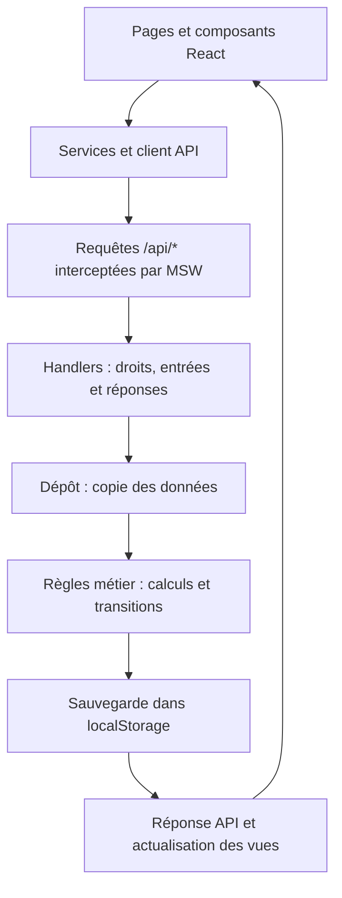

# AgriData Connect

**Plateforme de mise en relation agricole pour l’achat et la vente en gros de tomates et d’oignons au Maroc.**

AgriData Connect réunit producteurs, acheteurs et administration dans une application web en français. Elle permet de publier des lots, exprimer un besoin, négocier les conditions d’achat, passer une commande et suivre son traitement jusqu’à la réception, au règlement ou à la résolution d’un litige.

La version livrée couvre le périmètre fonctionnel **P0**, c’est-à-dire les fonctionnalités essentielles du projet. Il s’agit d’un **prototype fonctionnel autonome** : les écrans et les règles métier sont implémentés, les données sont persistantes dans le navigateur et les services externes sont simulés. Aucun paiement bancaire, e-mail ou transport réel n’est déclenché.

| Repère | Valeur |
| --- | --- |
| Version déclarée | `0.1.0` |
| Langue de l’interface | Français |
| Devise et unité | Dirham marocain (MAD), kilogramme (kg) |
| Espaces | Acheteur, agriculteur, administration |
| Données | Jeu fictif initial et modifications locales |
| Dernière recette documentée | 11 novembre 2026, critères AC01 à AC29 validés |
| Guide de présentation | [Scénario de démonstration de six minutes](presentation-demo.md) |

## Sommaire

- [Présentation du projet](#présentation-du-projet)
- [Fonctionnalités](#fonctionnalités)
- [Prérequis techniques](#prérequis-techniques)
- [Installation](#installation)
- [Démarrage et utilisation](#démarrage-et-utilisation)
- [Commandes disponibles](#commandes-disponibles)
- [Profils et données initiales](#profils-et-données-initiales)
- [Architecture technique](#architecture-technique)
- [Organisation des fichiers](#organisation-des-fichiers)
- [Règles de gestion](#règles-de-gestion)
- [Persistance et réinitialisation](#persistance-et-réinitialisation)
- [Navigation et routes](#navigation-et-routes)
- [Tests et validation](#tests-et-validation)
- [Ressources graphiques](#ressources-graphiques)
- [Préparer la remise du projet](#préparer-la-remise-du-projet)
- [Dépannage](#dépannage)
- [Limites et évolutions possibles](#limites-et-évolutions-possibles)
- [Documents de référence](#documents-de-référence)

## Présentation du projet

Le projet organise un parcours commercial commun aux acteurs de la filière agricole. L’acheteur peut consulter des offres existantes ou publier une demande. Le producteur propose ses lots et répond aux besoins. L’administration coordonne le transport, supervise les opérations financières et intervient en cas de litige.

Chaque commande conserve les conditions de l’accord : produit, quantité, prix, adresses et tarifs. Les événements, notifications et changements de statut permettent ensuite à chaque partie de retrouver le même suivi.

Le parcours principal est le suivant :

**Catalogue ou demande → discussion éventuelle → commande → paiement → collecte → livraison → réception conforme → versement au producteur.**

Les annulations, refus de paiement, remboursements, remplacements et suspensions sont intégrés à ce parcours. La remise signalée par le transporteur et la réception conforme confirmée par l’acheteur restent deux étapes distinctes.

## Fonctionnalités

### Consultation et fonctionnalités communes

- Accueil et catalogue accessibles sans sélectionner de profil.
- Recherche de lots, filtres par produit, ville et disponibilité, tri par prix ou publication.
- Fiche détaillée avec photo, origine, calibre, description, prix, stock disponible et minimum de commande.
- Sélection de profil, changement d’espace et déconnexion.
- Modification des coordonnées ; présentation de l’exploitation pour l’agriculteur et type professionnel ou particulier pour l’acheteur.
- Notifications persistantes, compteur de notifications non lues, lecture et accès à l’objet concerné.
- Interface adaptée aux ordinateurs et mobiles, champs étiquetés, navigation clavier et dialogues avec gestion du focus.

### Espace acheteur

- Achat direct d’un lot avec contrôle des quantités et récapitulatif financier.
- Publication, modification et fermeture de demandes d’achat.
- Messagerie avec le producteur, propositions et contre-propositions structurées.
- Acceptation ou refus d’une proposition et commande selon les conditions acceptées.
- Paiement simulé par carte Naps ou en agence Cash Plus, avec historique des tentatives.
- Consultation des commandes et de leur chronologie.
- Annulation avant paiement et confirmation de réception conforme.
- Signalement d’un problème après remise, ajout d’une photo locale facultative et commentaires dans le dossier.
- Signalement d’un problème sur un remplacement dans le même dossier.

### Espace agriculteur

- Publication d’offres avec photo choisie dans la bibliothèque locale.
- Modification des prix, quantités, minimums, descriptions et lieux de collecte.
- Désactivation d’une offre.
- Consultation des demandes ouvertes et réponse avec un lot compatible.
- Négociation avec les acheteurs et réponse aux propositions reçues.
- Suivi des commandes, collectes, livraisons et litiges.
- Consultation des montants dus, commissions, versements et motifs de blocage.

### Espace administration

- Tableau de bord calculé à partir des commandes et opérations enregistrées.
- Supervision des commandes et expiration manuelle des commandes non payées.
- Confirmation des encaissements en attente.
- Sélection d’un transporteur, planification de collecte et progression des étapes de livraison.
- Relance de l’acheteur après remise, sans confirmation automatique à sa place.
- Exécution des versements autorisés.
- Traitement des litiges : examen, commentaires, enregistrement de décision, puis exécution séparée.
- Remboursement total, accord financier partiel ou remplacement du même lot.
- Suspension et réactivation des comptes, offres et demandes, avec motif et historique.
- Vue financière distinguant encaissements, remboursements, commissions, transport, sommes versées et sommes dues.

## Prérequis techniques

| Élément | Besoin |
| --- | --- |
| Node.js | Plage déclarée dans `package.json` : `>=20.19.0 <21 \|\| >=22.12.0`. La recette a utilisé Node.js `20.19.2`. |
| npm | Gestionnaire de paquets fourni avec Node.js. Version déclarée et utilisée pour la recette : `10.8.2`. |
| Navigateur | Prise en charge de JavaScript, des Service Workers, de `localStorage` et de `sessionStorage`. Recette effectuée sur Microsoft Edge via Playwright. |
| Terminal | PowerShell, terminal Windows ou terminal compatible sur macOS/Linux. |
| Accès réseau | Nécessaire pour télécharger les dépendances et, si besoin, le navigateur de test. Les ressources de l’application sont ensuite servies localement. |
| Git | Facultatif pour lancer une archive du projet ; utile pour récupérer et versionner les sources. |

**Aucun serveur de base de données, Docker, compte bancaire, service de messagerie, clé API ou fichier `.env` n’est nécessaire.** Les dépendances de développement sont nécessaires pour compiler et tester le projet.

L’environnement de recette est Windows. Les scripts npm ne contiennent pas de chemin propre au poste de développement ; la configuration du navigateur de test est détaillée plus bas pour les autres environnements.

### Technologies utilisées

Versions relevées dans le fichier de verrouillage livré :

| Technologie | Version | Rôle |
| --- | --- | --- |
| React et React DOM | 19.2.4 | Interface et composants |
| TypeScript | 5.9.3 | Typage strict et vérification avant compilation |
| Vite | 8.3.7 | Serveur local, compilation et aperçu du build |
| React Router | 7.18.5 | Navigation et routes selon le profil |
| Mock Service Worker (MSW) | 2.15.0 | Interception des requêtes et API simulée |
| Vitest | 4.1.12 | Tests métier et tests d’intégration API |
| Playwright | 1.65.0 | Parcours automatisés dans le navigateur |
| Lucide React | 1.7.0 | Icônes de l’interface |
| CSS | Fichiers locaux | Styles, variables de marque et adaptation aux tailles d’écran |

`package.json` déclare les dépendances et les scripts. `package-lock.json` fixe les versions exactes installées par `npm ci`.

## Installation

### 1. Récupérer les sources

Extraire l’archive remise ou récupérer le dépôt fourni, puis ouvrir un terminal **dans le dossier contenant `package.json`**.

Sous PowerShell, adapter ce chemin à l’emplacement du projet :

```powershell
cd "C:\chemin\vers\Application_agridataConnect"
```

### 2. Vérifier les outils

```shell
node --version
npm --version
```

Vérifier que Node.js respecte la plage indiquée dans les prérequis.

### 3. Installer les dépendances

```shell
npm ci
```

Cette commande installe les versions du fichier de verrouillage. Elle est à privilégier pour reprendre le projet sur un autre poste. Conserver `package-lock.json` et installer aussi les dépendances de développement ; ne pas utiliser `--omit=dev` pour cette procédure.

Aucune étape de création de base de données, de migration ou de configuration d’identifiants n’est requise. Le jeu de données initial est créé automatiquement au premier chargement.

## Démarrage et utilisation

### Présenter la version livrée

Depuis le dossier du projet :

```shell
npm run build
npm run preview
```

Ouvrir **[http://127.0.0.1:4173/](http://127.0.0.1:4173/)**.

`build` vérifie TypeScript, puis génère les fichiers de l’application dans `dist/`. `preview` sert ces fichiers pour la présentation et la recette locale. Une modification des sources nécessite un nouveau build pour apparaître dans cet aperçu.

Le terme « build de production » désigne ici les fichiers compilés et optimisés. Les paiements et services métier restent simulés dans cette version.

### Reprendre le développement

```shell
npm run dev
```

Ouvrir **[http://127.0.0.1:5173/](http://127.0.0.1:5173/)**. Ce mode recharge les modifications pendant le travail sur les sources.

### Premières actions

1. Consulter le catalogue ou ouvrir `/connexion`.
2. Choisir l’un des cinq profils disponibles.
3. Utiliser la navigation de son espace.
4. Changer de profil dans l’en-tête pour poursuivre un même scénario avec un autre rôle.

Il n’y a pas de mot de passe à saisir. Le choix de profil représente les différents acteurs de la démonstration.

Le serveur doit rester actif dans le terminal pendant l’utilisation. Pour l’arrêter, utiliser **Ctrl+C**. Ne pas ouvrir `index.html` ou `dist/index.html` par double-clic : l’application doit être servie par HTTP.

Les ports 5173 et 4173 sont configurés en mode strict : si le port demandé est occupé, le serveur s’arrête avec un message au lieu de choisir automatiquement un autre port.

## Commandes disponibles

Toutes les commandes s’exécutent à la racine du projet.

| Commande | Utilisation |
| --- | --- |
| `npm ci` | Installer les versions exactes du verrouillage |
| `npm install` | Installer ou actualiser les dépendances lors d’une évolution volontaire du projet |
| `npm run dev` | Démarrer le serveur de développement sur le port 5173 |
| `npm run build` | Vérifier TypeScript strict et générer `dist/` |
| `npm run preview` | Servir `dist/` sur le port 4173 |
| `npm test` | Exécuter les tests Node, Vitest et d’intégration MSW |
| `npm run test:e2e` | Exécuter les scénarios Playwright sur le build |
| `npm run test:ui` | Ouvrir l’interface interactive des tests Playwright |

Le projet ne définit pas de commande `npm start`, de commande de lint ni de génération automatique de couverture de tests.

## Profils et données initiales

### Profils disponibles

| Profil | Rôle | Ville | Identifiant technique |
| --- | --- | --- | --- |
| Restaurant Jardin | Acheteur professionnel | Casablanca | `buyer-pro` |
| Acheteur particulier | Acheteur en gros à titre particulier | Rabat | `buyer-private` |
| Coopérative Atlas | Agriculteur | Agadir | `farmer-coop` |
| Ferme Amane | Agriculteur | Meknès | `farmer-farm` |
| Administration | Administrateur | Casablanca | `admin` |

Les identités et adresses e-mail en `.example` sont fictives. Les profils sont définis dans [src/app/profiles.ts](src/app/profiles.ts).

### Jeu de données

La graine située dans [src/mocks/seed/seedData.ts](src/mocks/seed/seedData.ts) prépare :

- cinq comptes, huit offres et trois demandes ouvertes ;
- deux conversations et des propositions en attente ;
- sept commandes couvrant plusieurs situations : paiement en attente, transport, réception, clôture, litige et annulation ;
- un litige ouvert, des notifications, un journal d’événements et deux transporteurs fictifs.

Toutes les offres ne sont pas nécessairement affichées dans le catalogue : leur statut, leur stock et les filtres déterminent leur visibilité. Les dates du jeu initial sont calculées à partir de l’instant de son initialisation ou de sa réinitialisation.

### Scénarios prêts à présenter

| Scénario | Point d’entrée |
| --- | --- |
| Achat complet | Restaurant Jardin, tomates rondes de Coopérative Atlas, commande de 500 kg |
| Attente Cash Plus | `/commandes/order-awaiting-payment/paiement`, avec Restaurant Jardin |
| Négociation | `/messages/conversation-offer`, avec Restaurant Jardin ou Coopérative Atlas |
| Confirmation de réception | `/commandes/order-awaiting-reception`, avec Restaurant Jardin |
| Résolution d’un litige | `/admin/litiges/dispute-delivery`, avec Administration |

Le [guide de présentation](presentation-demo.md) explique l’ordre des actions, le changement de profil et les variantes à rejouer depuis la graine.

## Architecture technique

L’application est une **SPA** : React affiche les pages dans le navigateur et React Router gère la navigation. Le serveur Vite fournit les fichiers de l’interface ; il n’héberge pas un serveur métier.

Au démarrage, [src/main.tsx](src/main.tsx) initialise MSW avant d’afficher React. Les appels `fetch` vers `/api/*` sont interceptés dans le navigateur et traités par les handlers locaux. Ce fonctionnement est également actif dans le build compilé.



Une mutation est appliquée sur une copie des données. Le dépôt ne publie le nouvel état qu’après une sauvegarde réussie. Si les règles refusent l’action ou si le stockage échoue, l’état précédent est conservé.

### Responsabilités des couches

| Couche | Responsabilité |
| --- | --- |
| `app/` | Routes, droits de navigation, session, contexte métier et structure commune |
| `components/` | Boutons, champs, dialogues et composants d’interface réutilisables |
| `features/` | Écrans et interactions des différents parcours |
| `domain/` | Modèles, calculs, droits métier, stock et transitions autorisées |
| `services/` | Client API, contrats TypeScript, chargement et suivi des requêtes |
| `mocks/handlers/` | Endpoints simulés, contrôle des accès et réponses JSON |
| `mocks/repository/` | Chargement, sauvegarde, validation du format et réinitialisation |
| `mocks/seed/` | Construction reproductible du jeu de données initial |
| `styles/`, `assets/`, `public/` | Présentation, association des photos et ressources locales |

Les composants passent par les services pour effectuer les opérations métier. Ils n’écrivent pas directement les données métier dans `localStorage`.

### Contrat API

Le client [apiClient.ts](src/services/apiClient.ts) utilise des réponses JSON :

```json
{ "data": { "id": "identifiant" } }
```

En cas d’échec, la réponse contient un code et un message :

```json
{
  "error": {
    "code": "FORBIDDEN",
    "message": "Cette action n’est pas autorisée pour votre profil."
  }
}
```

Le profil actif est transmis via `X-Demo-User-Id`. Certaines opérations sensibles utilisent `Idempotency-Key` pour reconnaître une nouvelle tentative de la même opération. Les handlers vérifient aussi le rôle, le propriétaire et l’état de l’objet.

Ces contrôles permettent de tester les permissions du prototype. Le choix de profil et son en-tête ne constituent pas une authentification destinée à un service public.

L’API étant interceptée dans le navigateur, une requête adressée à Vite depuis un outil externe ne se comporte pas comme un appel à un backend autonome. Les tests d’intégration utilisent MSW dans Node.js pour vérifier les mêmes handlers. Le détail des endpoints figure dans le [PRD](PRD_Prototype_AgriData_Connect.md).

## Organisation des fichiers

Arborescence principale, avec regroupement des fichiers secondaires :

```text
Application_agridataConnect/
├── src/
│   ├── main.tsx                    # Démarrage MSW, React et styles
│   ├── app/
│   │   ├── App.tsx                 # Routes et protections par rôle
│   │   ├── Layout.tsx              # En-tête, navigation et dialogues globaux
│   │   ├── SessionProvider.tsx     # Profil actif et déconnexion
│   │   ├── BusinessDataProvider.tsx
│   │   ├── profiles.ts             # Cinq profils disponibles
│   │   └── navigation.ts           # Liens de chaque espace
│   ├── components/
│   │   └── ui.tsx                  # Composants partagés
│   ├── features/
│   │   ├── home/                  # Accueil
│   │   ├── session/               # Sélection et modification des profils
│   │   ├── purchase/              # Catalogue, commande, paiement et suivi
│   │   ├── trading/               # Offres, demandes, messages et propositions
│   │   ├── admin/                 # Tableau de bord, finance, litiges, modération
│   │   └── workspace/             # Notifications et outils techniques
│   ├── domain/
│   │   ├── types.ts               # Entités et statuts
│   │   ├── access.ts              # Accès aux espaces
│   │   ├── businessOperations.ts  # Règles et mutations métier
│   │   ├── finance.ts             # Réconciliation et indicateurs
│   │   └── *.test.ts              # Tests métier
│   ├── services/
│   │   ├── apiClient.ts           # Appels API et erreurs
│   │   ├── contracts.ts           # Types des réponses et vues
│   │   ├── demoSession.ts         # Persistance de la session
│   │   └── useApi.ts              # Hooks de chargement et de mutation
│   ├── mocks/
│   │   ├── browser.ts             # Configuration du worker MSW
│   │   ├── handlers/              # Endpoints et tests d’intégration
│   │   ├── repository/            # Dépôt et stockage local
│   │   └── seed/                  # Données initiales et paramètres
│   ├── assets/
│   │   └── produce.ts             # Bibliothèque de photos par produit
│   └── styles/                    # Variables de marque et styles des modules
├── public/
│   ├── brand/                     # Logos, favicons et icône d’application
│   ├── fonts/                     # Polices locales, licences et crédits
│   ├── produce/                   # Huit photos JPEG et crédits
│   └── mockServiceWorker.js       # Worker MSW nécessaire au navigateur
├── tests/
│   ├── foundations.test.mjs       # Tests Node de fondation et persistance
│   └── *.spec.ts                  # Parcours Playwright
├── Logos/                         # Ressources originales de marque
├── index.html                     # Entrée HTML de Vite
├── package.json                   # Dépendances, scripts et prérequis
├── package-lock.json              # Versions exactes des dépendances
├── tsconfig.json                  # Configuration TypeScript stricte
├── vite.config.mjs                # Serveurs et compilation
├── vitest.config.mjs              # Tests unitaires et API
├── playwright.config.ts           # Navigateur, serveur et scénarios de recette
├── README.md                      # Documentation de livraison
├── PRD_Prototype_AgriData_Connect.md
├── AgriData_Connect_Charte_essentielle.pdf
├── parcourt_utilisateur.png
├── validation-finale.md            # Recette AC01 à AC29
├── validation-etapes-1-3.md
├── validation-etape-4.md
├── presentation-demo.md            # Déroulé de présentation
├── to-do.md                        # Suivi de réalisation
├── AGENTS.md                       # Consignes d’intervention dans le dépôt
└── bachirou.md                     # Notes personnelles réservées
```

Dossiers générés et exclus de Git : `node_modules/`, `dist/`, `.cache/`, `test-results/` et `playwright-report/`.

Pour faire évoluer le projet, conserver les règles métier dans `domain/`, les contrats dans `services/` et les contrôles d’accès dans les handlers. Les tests unitaires utilisent `*.test.ts` et les parcours navigateur `*.spec.ts`. Les textes d’interface sont en français et les styles communs reposent sur les variables de `styles/tokens.css`.

## Règles de gestion

### Quantités, prix et stock

Les quantités sont exprimées en kilogrammes entiers et les montants sont calculés en centimes de MAD. Le disponible correspond au stock restant diminué des réservations actives.

La confirmation de commande réserve le stock. Le paiement réussi convertit cette réservation en vente. Un paiement refusé conserve la réservation pour permettre une nouvelle tentative. Une annulation ou expiration avant paiement libère la réservation et invalide les tentatives en attente.

Les conditions de la commande sont figées : une modification ultérieure d’un profil, d’une offre ou d’un tarif ne réécrit pas l’accord déjà enregistré.

### Calcul des montants

Paramètres du jeu initial :

- frais de livraison : **150 MAD + 0,25 MAD par kg** ;
- commission : **4 % du montant des produits**, arrondie au centime ;
- net agriculteur : montant des produits moins commission.

Exemple de référence :

| Poste | Calcul | Montant |
| --- | --- | --- |
| Produits | 500 kg × 3,40 MAD | 1 700,00 MAD |
| Livraison | 150 + 500 × 0,25 | 275,00 MAD |
| Total acheteur | Produits + livraison | 1 975,00 MAD |
| Commission | 4 % × 1 700 | 68,00 MAD |
| Net agriculteur | 1 700 − 68 | 1 632,00 MAD |

Les encaissements comprennent les ventes et le transport ; ils ne représentent pas à eux seuls le revenu de la plateforme. La commission est suivie séparément.

### Propositions et demandes

Accepter une proposition ne crée aucune commande et ne réserve aucun stock. L’acheteur prépare ensuite sa commande avec le prix, la quantité et les conditions de l’accord ; le disponible est revérifié.

Une proposition ne produit qu’une commande. Une demande est limitée à une commande active. Sa modification, sa fermeture ou sa suspension invalide les propositions concernées. Une annulation avant paiement peut rouvrir la demande, sans réactiver les anciennes propositions.

### Paiement, livraison et versement

Un paiement Naps peut être déclaré refusé puis relancé. Cash Plus produit une référence `DEMO-CP-` et reste en attente jusqu’à confirmation administrative. Une ancienne tentative invalidée après changement de moyen ne peut plus être encaissée.

La livraison suit les étapes : **collecte planifiée → produits récupérés → en livraison → remise signalée → réception conforme**. Le versement normal devient disponible après confirmation de l’acheteur. Une relance ne confirme ni ne clôture la commande automatiquement.

### Litiges et modération

| Résolution | Conséquence |
| --- | --- |
| Remboursement total | Produits et transport remboursés, aucun versement au producteur, commande clôturée |
| Accord partiel | Remboursements produits/transport séparés, commission recalculée sur les produits conservés, clôture après versement du net restant ou immédiatement si le net est nul |
| Remplacement | Contrôle et déduction unique du stock, deuxième cycle de livraison, premier historique conservé, aucun second paiement acheteur |

Enregistrer une décision ne l’exécute pas. L’exécution fait l’objet d’une action et d’une confirmation distinctes. Un remboursement ne restaure pas automatiquement le stock vendu. Le périmètre P0 autorise un seul remplacement ; un problème sur celui-ci impose une résolution financière dans le même dossier.

Une suspension exige un motif et empêche de nouvelles transactions. Les engagements existants restent traitables : suivi, paiement, réception et commentaires selon les droits du participant. Seule l’administration réactive une annonce suspendue.

## Persistance et réinitialisation

### Où sont conservées les données ?

| Stockage | Clé | Contenu |
| --- | --- | --- |
| `localStorage` | `agridataconnect.demo.v1` | Document métier JSON versionné : offres, commandes, stocks, échanges, opérations et notifications |
| `sessionStorage` | `agridataconnect.demo.session.v1` | Identifiant du profil actif dans l’onglet |

Un rechargement conserve les données métier. La déconnexion retire la session sans effacer les transactions. Un échec de sauvegarde ou un document incompatible produit une erreur explicite ; les données ne sont pas effacées silencieusement.

Le stockage dépend de l’adresse utilisée. **`127.0.0.1:5173`, `127.0.0.1:4173` et `localhost:4173` correspondent à des origines distinctes** : leurs jeux de données peuvent donc être différents. Conserver la même adresse et un seul onglet pendant une démonstration.

Les données saisies dans le navigateur ne sont pas enregistrées dans les sources du projet et ne sont pas transférées en copiant le dossier sur un autre ordinateur. Un nouveau navigateur ou une nouvelle origine reçoit le jeu initial.

### Réinitialiser la démo

1. Choisir **Administration** dans `/connexion`.
2. Ouvrir **`/outils-techniques`**, par exemple [depuis l’aperçu local](http://127.0.0.1:4173/outils-techniques).
3. Cliquer sur **Réinitialiser les données**.
4. Cliquer sur **Confirmer la réinitialisation**.

Les modifications et transactions des essais sont remplacées par la graine initiale. La session et les clés appartenant aux autres applications sont conservées. Le reset n’est pas annulable depuis l’interface.

### Autres outils techniques

Cette page, réservée à l’administration et absente de la navigation métier, permet aussi de :

- consulter le journal des e-mails fictifs, sans envoi réel ;
- forcer une erreur sur la prochaine requête API afin de vérifier le message et la reprise.

Après activation d’une erreur forcée, poursuivre par les liens internes de l’application. Un rechargement complet remet à zéro ce contrôle conservé en mémoire.

## Navigation et routes

Les routes privées vérifient le rôle ; les endpoints vérifient également le propriétaire de l’objet.

| Espace | Routes principales |
| --- | --- |
| Public | `/`, `/connexion`, `/offres`, `/offres/:id` |
| Profil connecté | `/profil` |
| Messagerie acheteur/agriculteur | `/messages`, `/messages/:id` |
| Acheteur | `/acheteur/demandes`, `/acheteur/commandes`, `/commande/nouvelle`, `/commandes/:id/paiement` |
| Agriculteur | `/agriculteur/offres`, `/demandes`, `/demandes/:id`, `/agriculteur/commandes`, `/agriculteur/reglements` |
| Suivi partagé autorisé | `/commandes/:id` |
| Administration | `/admin`, `/admin/commandes`, `/admin/paiements`, `/admin/litiges`, `/admin/litiges/:id`, `/admin/moderation` |
| Outils techniques | `/outils-techniques` |

`:id` représente l’identifiant de l’objet. Par exemple, `/commandes/order-disputed` ouvre une commande initiale selon les droits du profil actif.

## Tests et validation

### Tests métier et API

```shell
npm test
```

La commande exécute les tests Node des fondations, puis Vitest sur `src/**/*.test.ts`. Les tests portent notamment sur les calculs, réservations, permissions, transitions, propositions, remboursements, remplacements, répétitions d’opérations et erreurs de stockage.

### Tests navigateur

**Arrêter d’abord tout aperçu sur le port 4173 avec Ctrl+C.** Playwright démarre et arrête son propre serveur ; sa configuration ne réutilise pas un serveur déjà lancé.

```shell
npm run build
npm run test:e2e
```

Sous Windows, la configuration utilise par défaut **Microsoft Edge installé**.

Pour utiliser le navigateur Chromium fourni par Playwright sous Windows :

```powershell
npx playwright install chromium
$env:PLAYWRIGHT_CHANNEL = "chromium"
npm run test:e2e
```

Cette variable s’applique au terminal courant. Pour revenir à Edge dans ce terminal, définir `$env:PLAYWRIGHT_CHANNEL = "msedge"`.

Sur macOS/Linux, la configuration utilise par défaut Chromium de Playwright :

```shell
npx playwright install chromium
npm run test:e2e
```

L’installation du navigateur est une préparation des tests, distincte du fonctionnement de l’application dans un navigateur déjà installé. Les dépendances système demandées par Playwright doivent être disponibles sur le poste de test.

### Résultats de référence

La [recette finale du 11 novembre 2026](validation-finale.md) consigne :

| Vérification | Résultat documenté |
| --- | --- |
| Tests Node | 14 réussis |
| Tests Vitest et API | 131 réussis |
| Total métier, API et fondations | 145 réussis |
| Scénarios Playwright | 45 réussis |
| Recontrôles après finitions | 9 scénarios ciblés réussis, déjà inclus dans les parcours précédents |
| Compilation | TypeScript strict et build Vite réussis |
| Critères fonctionnels | AC01 à AC29 validés |
| Affichage | 1440 × 900, 1366 × 768, largeurs mobiles 390 et 360 px |

Ces chiffres décrivent la recette consignée dans le dépôt. Une nouvelle exécution doit être réalisée sur le poste de remise pour confirmer son environnement.

Les captures sont écrites dans `.cache/screenshots/`. Les captures d’échec et traces Playwright sont conservées dans `test-results/`. Ces sorties ne sont pas versionnées. Aucun seuil de couverture automatique n’est défini.

## Ressources graphiques

La charte du projet détermine les couleurs et la typographie. Les variables de marque sont centralisées dans [src/styles/tokens.css](src/styles/tokens.css).

| Ressource | Emplacement et références |
| --- | --- |
| Logos originaux | `Logos/` |
| Logos utilisés, favicons et icône | `public/brand/` |
| Photos des produits et preuves de bibliothèque | `public/produce/`, [sources et crédits](public/produce/CREDITS.md) |
| Polices Hepta Slab, Readex Pro et Martian Mono | `public/fonts/`, [sources et licences](public/fonts/CREDITS.md) |
| Icônes | Bibliothèque Lucide React |

Les polices sont accompagnées de leurs licences SIL Open Font License. Les photographies illustrent les types de produits ; elles ne certifient pas l’origine ou le calibre de lots réels.

Les images, logos et polices sont servis localement. Aucun appel à Google Fonts ou à un service de photos distant n’est nécessaire pendant la navigation. Conserver les crédits et licences lors de la remise.

Le dépôt ne contient pas de fichier `LICENSE` définissant une licence globale pour le code du projet. Les licences des ressources tierces restent distinctes.

## Préparer la remise du projet

### Contenu à fournir

Remettre au minimum :

- `src/`, `public/` et `index.html`, avec toutes les ressources et le worker MSW ;
- `package.json`, `package-lock.json` et les configurations TypeScript, Vite, Vitest et Playwright ;
- `tests/` et les tests colocalisés dans les sources ;
- ce README, le PRD, la recette finale et le scénario de présentation ;
- la charte, les ressources originales de marque et les documents de suivi utiles à l’évaluation.

Conserver les fichiers de configuration du dépôt, notamment `.gitignore` et `.editorconfig`. `AGENTS.md` contient les consignes pour les interventions automatisées ; les commandes et dépendances effectivement livrées sont définies dans `package.json` et les configurations.

Ne pas inclure `node_modules/` dans une archive de remise : ce dossier est recréé avec `npm ci`. Les caches, journaux, traces et rapports générés ne sont pas nécessaires à l’installation. Joindre les captures séparément si elles sont demandées comme preuves.

`dist/` peut être joint comme build prêt à servir, mais il ne remplace pas les sources et doit être généré à partir de la version remise. Il est ignoré par Git.

### Vérification avant transmission

Sur une copie du dossier remis, avec le port 4173 libre :

```shell
npm ci
npm test
npm run build
npm run test:e2e
npm run preview
```

Avant la présentation :

1. Ouvrir l’aperçu sur `http://127.0.0.1:4173/`.
2. Réinitialiser les données depuis le profil Administration.
3. Vérifier les cinq profils, les photos et les principales pages.
4. Garder un seul onglet et la même adresse pendant le scénario.
5. Suivre [presentation-demo.md](presentation-demo.md), qui prévoit des commandes distinctes pour l’achat principal, Cash Plus, la négociation et les litiges.

### Hébergement éventuel

La remise locale fonctionne avec `npm run preview`. Pour un hébergement distinct, fournir les fichiers de `dist/` et configurer le serveur pour renvoyer `index.html` lors de l’ouverture directe d’une route React.

La configuration actuelle suppose un site à la racine du domaine : les ressources et le worker utilisent des chemins absolus. Un hébergement dans un sous-dossier demande une adaptation du routage, des chemins de ressources et du worker.

Les Service Workers nécessitent un contexte sécurisé : utiliser HTTPS sur un hébergement distant ; les adresses locales de développement conviennent aux essais. Le build hébergé reste une démonstration avec données propres à chaque navigateur, pas un service partagé entre utilisateurs.

## Dépannage

| Situation | Vérification ou action |
| --- | --- |
| `node` ou `npm` introuvable | Installer une version compatible de Node.js puis rouvrir le terminal. |
| PowerShell refuse `npm.ps1` | Utiliser `npm.cmd` à la place de `npm`, par exemple `npm.cmd ci`, ou utiliser l’invite de commandes. |
| `package.json` introuvable | Se placer à la racine du projet avant de lancer les commandes. |
| Erreur de version Node.js | Comparer `node --version` à la plage `engines` de `package.json`. |
| Installation bloquée par le réseau | Vérifier l’accès au registre npm et la configuration réseau ou proxy du poste, puis relancer `npm ci`. |
| Port 5173 ou 4173 déjà utilisé | Arrêter le serveur correspondant dans son terminal. Le mode strict interdit le basculement automatique vers un autre port. |
| `npm start` échoue | Utiliser `npm run dev` ou `npm run build` suivi de `npm run preview`. |
| Aperçu absent ou ancien | Exécuter `npm run build` avant de relancer `npm run preview`. |
| Page vide ou API indisponible | Utiliser HTTP sur l’adresse locale indiquée, vérifier JavaScript et les Service Workers, ainsi que la présence de `public/mockServiceWorker.js` dans les sources et du worker dans le build. |
| Données différentes d’un essai précédent | Vérifier le navigateur, le profil et surtout l’origine : hôte et port. Le développement et l’aperçu n’utilisent pas le même stockage. |
| Données illisibles ou incompatibles | Passer Administration puis ouvrir les outils techniques pour une réinitialisation explicite, après avoir accepté la perte des essais locaux. |
| Sauvegarde impossible | Vérifier que le navigateur autorise le stockage du site et dispose de place. Rétablir le stockage avant de relancer l’action. |
| Playwright ne trouve pas son navigateur | Installer Edge sous Windows ou installer Chromium et choisir le canal indiqué dans la section tests. |
| Playwright indique un serveur déjà présent | Arrêter `npm run preview` sur 4173 avant `npm run test:e2e`. |
| Erreur `spawn EPERM` dans un environnement restreint | L’environnement doit autoriser le lancement du navigateur et des processus de test. Utiliser un terminal disposant de ces autorisations. |
| Un nouvel achat est refusé | Vérifier le minimum, le disponible, le statut de l’offre et celui des comptes ; recalculer le récapitulatif si le prix a changé. |
| Une référence Cash Plus ne peut plus être confirmée | Vérifier si elle a été invalidée par un changement de moyen, une annulation ou une expiration. |
| Le versement reste bloqué | Vérifier la réception conforme et l’état du litige ; une décision non exécutée ne libère pas le versement. |

## Limites et évolutions possibles

Le périmètre livré est une démonstration locale des fonctionnalités P0 :

- les comptes sont sélectionnés parmi des profils fictifs, sans inscription ni authentification réelle ;
- l’API et les contrôles de rôle s’exécutent dans le navigateur ;
- les paiements Naps/Cash Plus, remboursements, versements, e-mails et transports sont simulés ;
- les données ne sont ni centralisées ni synchronisées entre appareils ou onglets ;
- le scénario garanti utilise un seul onglet ;
- les images sont choisies dans une bibliothèque locale ;
- la recette navigateur porte sur Edge/Chromium et ne constitue pas une validation exhaustive sur tous les navigateurs ni un audit complet d’accessibilité.

Les options P1 ne font pas partie de cette livraison : inscription et récupération de mot de passe, comparateur dédié, historique de prix, import d’images personnelles et export d’un récapitulatif de commande.

Une évolution vers un service réel nécessiterait notamment un backend, une base de données partagée, une authentification et des permissions côté serveur, ainsi que les intégrations externes et la gestion de leur exploitation.

## Documents de référence

| Document | Contenu |
| --- | --- |
| [PRD](PRD_Prototype_AgriData_Connect.md) | Exigences, règles, architecture cible, contrats API et critères d’acceptation |
| [Charte graphique](AgriData_Connect_Charte_essentielle.pdf) | Identité visuelle du projet |
| [Parcours utilisateur](parcourt_utilisateur.png) | Schéma du parcours |
| [Recette finale](validation-finale.md) | Résultats, matrice AC01 à AC29, revue des écrans et limites de validation |
| [Validation des étapes 1 à 3](validation-etapes-1-3.md) | Historique de recette des fondations et de l’achat |
| [Validation de l’étape 4](validation-etape-4.md) | Historique de recette de la publication et de la négociation |
| [Présentation](presentation-demo.md) | Oral de six minutes, scénarios et reprise après incident |
| [Suivi du projet](to-do.md) | Travaux réalisés et options restantes |
| [Crédits des photos](public/produce/CREDITS.md) | Auteurs, sources et conditions d’utilisation des images |
| [Crédits des polices](public/fonts/CREDITS.md) | Sources et licences des trois familles |
