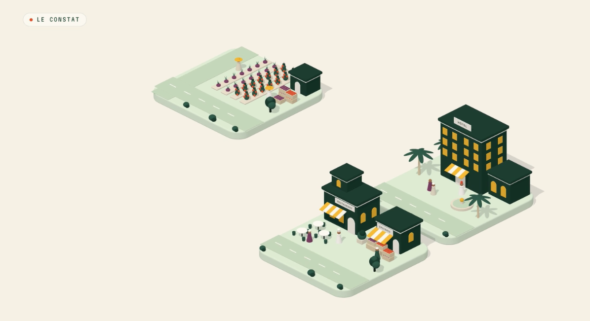
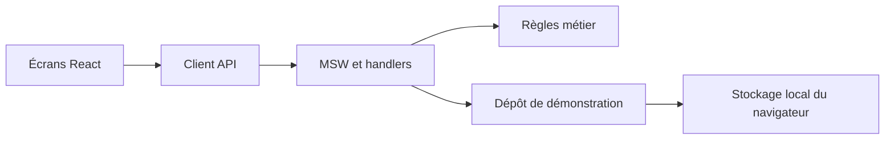

# AgriData Connect

[](https://www.youtube.com/watch?v=gnwLyldnhD4)

## Le projet en bref

AgriData Connect met en relation des producteurs agricoles et des acheteurs en gros au Maroc. La plateforme accompagne une commande depuis la publication d’une offre ou d’un besoin jusqu’à la livraison, la réception et au versement au producteur.

Le projet est un prototype web fonctionnel en français. Les paiements, les transports, les notifications et les versements sont simulés. Les données de démonstration sont conservées localement dans le navigateur.

## Ce que l’application permet

- **Acheteur :** parcourir les offres de tomates et d’oignons, publier un besoin, discuter et négocier, passer une commande, simuler un paiement et confirmer la réception.
- **Producteur :** publier et gérer ses offres, répondre aux demandes, négocier et suivre ses commandes et règlements.
- **Administration :** organiser les livraisons, suivre les paiements, traiter les litiges, gérer les remboursements et effectuer les versements simulés.

La commission de démonstration est de **3 %** sur la valeur des produits.

## Parcours principal

**Offre ou demande → échange éventuel → commande → paiement simulé → collecte et livraison → confirmation de réception → versement simulé.**

## Organisation du code

```text
src/
  app/          Démarrage de l’application, routes, navigation et profils
  components/   Composants d’interface réutilisables
  domain/       Types, règles métier, calculs financiers et tests
  features/     Écrans et fonctions par espace utilisateur
  mocks/        API simulée, données initiales et stockage local
  services/     Client API et contrats de données
  styles/       Styles et variables visuelles
  assets/       Ressources utilisées par le code
public/         Logos, photos, polices et worker MSW
tests/          Tests des parcours et du stockage
Aseets/         Visuels du projet, dont la miniature de cette vidéo
```

## Architecture technique

L’interface React appelle un client API commun. Mock Service Worker (MSW) intercepte ces appels et applique les règles métier du domaine. Le dépôt partagé sauvegarde l’état de démonstration dans le stockage local du navigateur.



## Technologies

- React et TypeScript pour l’interface et les règles typées.
- Vite pour le serveur de développement et la compilation.
- React Router pour les pages et les espaces selon le profil.
- MSW pour simuler l’API sans serveur distant.
- Vitest et Playwright pour les tests métier et les parcours dans le navigateur.
- CSS pour les styles et l’adaptation aux écrans mobiles.

## Installation rapide

Prérequis : Node.js `20.19+` ou `22.12+` et npm.

```bash
npm ci
npm run dev
```

Ouvrir ensuite l’adresse locale affichée dans le terminal. Choisir un profil sur l’écran de connexion pour accéder à l’espace acheteur, producteur ou administration. Aucun mot de passe réel n’est requis.

Commandes utiles :

```bash
npm test           # tests de règles métier et API simulée
npm run test:e2e   # parcours automatisés dans le navigateur
npm run build      # vérification TypeScript et build de production
npm run preview    # aperçu local du build
```

## État du projet et suite

Le périmètre P0 du prototype est réalisé. Les 29 critères d’acceptation sont validés dans la recette du projet. 

Les détail du readme se trouve dans [README détaillé](README-detaille.md), le [compte rendu de recette](validation-finale.md).

Pour transformer le prototype en service commercial, il restera à définir et réaliser notamment :

- un backend et une base de données sécurisés, avec une authentification réelle ;
- l’intégration contractuelle de paiements et de remboursements réels ;
- des accords et connexions avec des transporteurs, ainsi que les règles opérationnelles de livraison ;
- les exigences de sécurité, de confidentialité, de conformité et de support ;
- l’hébergement de production, la supervision et les procédures de maintenance.

Ces éléments ne sont pas nécessaires pour la démonstration actuelle et ne sont pas implémentés dans ce prototype.

## Documents du projet

- [PRD du prototype](PRD_Prototype_AgriData_Connect.md)
- [README détaillé](README-detaille.md)
- [Charte visuelle](AgriData_Connect_Charte_essentielle.pdf)
- [Suivi des tâches](to-do.md)
